# Pageread as a virtual page blackboard

[Reading map](./README.md) · [Virtual structure](./structure0.gpt6a.md) · [Work lifecycle](./work0.gpt6a.md)

## 1. Thesis

**A page becomes a shared, inspectable working surface in our own semantic space.
Sensors contribute items. Workers recognize opportunities in those items, attach
their work beneath them, and contribute further items. The structure records both
what we understand and how that understanding is being made.**

The observed website remains the source. Pageread owns the blackboard and its
view. By default, it does not inject the semantic tree, annotations, status badges,
custom elements, or work records into the source page's DOM. Our view can render
all of those things from the virtual graph.

This is the human's requested integrating direction. The data vocabulary,
received-record details, scheduler, and serialization below are proposals. They
connect existing designs and experiments; they do not describe a shipped
blackboard runtime.

## 2. The central object is an item with an inspectable neighborhood

An entry is an **item**: an identity, types, properties, references, revisions,
and a place in a meaningful structure. A message, a worker, a selector, a result
batch, a pending representation, and a work record can all be items.

Their roles remain explicit. A message's text is source/derived content. A worker's
selector describes applicability. A `received` child records engagement with an
input. A result points at produced content. A store receipt reports a particular
commit. Their common item representation makes them composable and inspectable
without making those meanings interchangeable.

A useful default presentation is:

```text
blackboard
├─ workers
│  └─ message-reader
│     ├─ selector: the page/board material it reads
│     ├─ accepts / requires / produces
│     └─ implementation: pinned module or installed script binding
├─ source-page
│  ├─ source identity, current epoch, coverage
│  └─ entry: message m42, observed revision r7, batch b12
│     ├─ observed fields and source selection
│     ├─ received: work w9, by message-reader
│     │  ├─ decision: accepted
│     │  ├─ attempt a1: started
│     │  ├─ produced: reference to normalized message n3
│     │  └─ settled: succeeded
│     └─ received: work w10, by another candidate worker
│        └─ decision: rejected, with scoped reason
└─ produced item n3
   └─ received: work w11, by the Oxigraph receiver
      └─ committed: store receipt c8
```

The work normally has an explanatory home under its input item. Graph references
also let us find it from the worker, result, operation, or batch. The tree is a
useful view of a richer graph; it does not force multi-input work to invent one
causal parent. [Structure](./structure0.gpt6a.md) defines these relationships.

## 3. How the pieces fit

```mermaid
flowchart LR
    source["Observed page / network / retained source"] --> sensor["Sensor routine"]
    sensor --> entries["Virtual entry items + batches"]
    definitions["Worker definitions + selectors + contracts"] --> matching["Match and bind"]
    entries --> matching
    matching --> agenda["Eligible activations / waiting requirements"]
    agenda --> received["Append received/work child to input"]
    received --> decision["Accept, wait, reject, or reuse"]
    decision --> attempt["Owned execution attempt"]
    attempt --> production["Proposed/ready output items"]
    production --> entries
    attempt --> progress["Work transitions and reasons"]
    production --> receiver["Selected store / delivery receiver"]
    receiver --> receipts["Commit or delivery receipts"]
    entries --> view["Our microdata/custom-element inspector"]
    progress --> view
    receipts --> view
```



This has the useful blackboard roles of shared working knowledge, participating
workers, and activation control. The host can begin with explicit registrations
and a small scheduling queue. A general inference engine is not required.

### Sensors contribute observations

A sensor routine is a reusable query/procedure. Bound software sensors evaluate
sources and publish immutable observed values in identified batches. Selectors
reuse Web Annotation where its source/segment semantics apply. Inputs carry
source scope, revision, and coverage; DOM or network gaps remain visible.

### Workers advertise and produce

A worker declaration describes its selector, accepted inputs, required services,
produced content, and activation policy. A factory/template binds those inputs
and services to an instance. That instance may maintain output proactively,
respond to demand, or carry out an explicit command.

The graph may advertise an output before its body exists. A declared transcript,
annotation set, or telemetry representation can be waiting, building, ready, or
failed. A failed new production can leave an earlier ready revision usable.

An item describing code or a worker becomes executable through the host's
installed/enabled definition and activation policy. Observing worker-like markup
on a source page does not itself register or activate a worker.

### Work leaves a local account

When a worker actually receives a candidate input, it creates an identified
engagement beneath that input. The `received` child is the visible beginning of
the account. It gains decisions, attempt references, progress, produced outputs,
or a rejection reason. Silence is no longer the only explanation for why an
eligible-looking entry did not produce anything.

The [work note](./work0.gpt6a.md) separates receipt, acceptance, execution,
production, persistence, and delivery. It also distinguishes a worker refusing
an input from a worker failing during execution.

### Receivers contribute effects and receipts

An Oxigraph receiver consumes proposed content and writes it through its commit
boundary. An exporter consumes a pinned representation and delivers it to a
chosen destination. Each can leave its own work child and explicit receipt.
Producer completion, store commitment, and remote acknowledgement are separate
facts that our view can follow through references.

## 4. The blackboard is virtual by default

Three spaces must be explicit:

| Space | Purpose | Default mutation policy |
| --- | --- | --- |
| **Observed page** | Source of DOM/network evidence and ephemeral navigation anchors | No blackboard materialization or annotation/work UI injection |
| **Virtual item graph** | Item identities, evidence, definitions, work, proposals, selected outputs | Mutated through host publication/append operations |
| **Owned view** | Inspect, annotate, query, and control the graph | Render and update our own document/custom elements |

A content script sharing access to the page DOM is not our private blackboard
container. Hiding a subtree or using a shadow root would still modify the page.
Use an extension page, panel, companion workbench, or detached representation
for our rendering. A source-mutating capability would be a separately declared
operation; it is not necessary for blackboard participation.

This specifies our DOM footprint. It does not claim that every capture mechanism,
such as page-world network instrumentation, is undetectable or has zero effect.
Reader inputs should normally be immutable copied values plus explicit source
handles, keeping general processors away from accidental DOM writes.

## 5. Work structure is operational state, not changed source content

This is a central invariant: **appending work under an entry does not change the
entry's source-content revision.** Otherwise a worker could trigger itself merely
by writing “received,” then again when it writes “running.”

Keep at least these coordinates distinct:

- Source/content revision: what the entry says about the observed subject.
- Board publication cursor: what changed anywhere in the shared surface.
- Work revision/sequence: how a particular engagement or attempt progressed.
- Selected output generation: which completed production consumers should use.

Worker selectors and dependencies name the data plane and fields they consume.
The renderer may show source fields and work children together, but a broad DOM
subtree hash is not an input revision. Operational children do not implicitly
become newly observed message text or source microdata.

The initial host separates evidence, derived content, definitions, annotations,
and control/work changes for routing. Workers that inspect work records can
explicitly subscribe to that plane. Ordinary message readers subscribe to content
changes. Cycles require declared semantics; default execution excludes a
producer's own control/output updates from its input triggers.

## 6. Small parts worth making independently useful

| Part | Narrow promise | How it contributes to the thesis |
| --- | --- | --- |
| Virtual item model | Identity, types, properties, references, and typed child attachments | A shared representable structure for content and work |
| Selector toolkit | Construct, refine, resolve, and explain source selections | Workers can state precisely what they read |
| Shared observation router | Walk/live values with ownership, epochs, immutable extraction | Multiple sensors can observe efficiently and coherently |
| Batch codec | Per-entry batch IDs, ordering, seal/abort, scope | Values can be grouped, delivered, and replayed honestly |
| Received/work protocol | Idempotent engagement, reasons, attempts, terminal outcomes | Progress and non-participation become queryable |
| Activation/binding host | Match contracts, resolve providers, own execution | Factories waiting for entries become concrete behavior |
| Annotation kit | Bodies and targets with pinned evidence and provenance | Agents enrich items, selectors, code, and results |
| Receiving store | Commit selected representations/graphs and return receipts | Durable knowledge survives transient reading sessions |
| Private inspector | Render the item/work neighborhood and expose commands | The blackboard becomes understandable to people |

These are capabilities with small testable interfaces, not a requirement for
nine packages. Their value is the set of contracts they share.

## 7. One message, several participants

1. The page sensor observes m42 at r7 and publishes entry e42 in sealed batch b12.
2. A message reader's selector identifies e42. Delivery appends received/work w9
   beneath it, naming the reader definition, selector, and exact input revision.
3. It accepts the input, resolves a processor binding, and starts attempt a1.
4. Another considered worker receives e42 but rejects its media/shape profile.
   Its own child records the expected profile, actual profile, and reason.
5. The reader produces normalized message n3 with derivation back to e42. Its
   execution completes; n3 is a separately identified output.
6. An annotation worker receives n3, targets a phrase, and publishes an annotation
   proposal. The proposal can be inspected before or independently of persistence.
7. A configured store receiver receives n3 and the proposal, commits them, and
   records the receipt. A failure here remains a store-stage outcome rather than
   retroactively making the extraction fail.
8. A newer source revision r8 arrives while some r7 work is still running. The old
   work remains evidence about r7; only an eligible new generation advances the
   current output. The view can show both accounts beneath their input revisions.

All of this happens in our virtual graph/private view. The original message DOM
does not acquire any of these child elements.

## 8. Existing designs retain their jobs

| Existing home | Contribution to the integrated architecture |
| --- | --- |
| [Sensor routines](../observation-queries/sensor-routines0.gpt6a.md) | Small authoring vocabulary, declarative structure, module leaves, keyed child bindings |
| [Blackboard production](../observation-queries/blackboard0.gpt6a.md) | Proactive output declarations, receivers, and encoding/delivery distinctions |
| [Query/annotation design](../observation-queries/design0.gpt6a.md) | SOSA mapping, selectors, structural microdata, batches, annotation tools |
| [Ontology-forward design](../ontology/design0.gpt6a.md) | Evidence and resolution graphs, provenance, coherent generations, portable bundles |
| [Tabula-rasa contracts](../tabula-rasa/design0.gpt6a.md) | Read/live handoff, immutable projection, separate revision tokens, publication and watch semantics |
| [Script-first host](../script-runtime/design0.gpt6a.md) | Discoverable code artifacts, local installation, runtime adapters, execution ownership |
| [RDF adaptation assessment](../tabula-rasa/rdf-adapt0.glm53m.md) | Need for one owned vocabulary/profile source and generated mappings rather than further hand-maintained drift |

The virtual blackboard does not settle the physical storage choice. It can start
over preserved documents plus a graph projection. An Oxigraph-native semantic
host can follow the explicit authority transition already proposed. Transient
observation and durable publication remain separately described.

The archived [compute-fabric vocabulary translation](file:///home/rektide/archive/doc/compute-fabric/README.md#vocabulary-translation)
is a useful precedent: shared context, operations, executor attempts, durable
receipts, and completion are related but distinct. Its
[iso-chill lineage account](file:///home/rektide/archive/doc/compute-fabric/lineage/iso-chill0.gpt56sol.md)
describes independently scheduled participants over shared process context and
later nested operations. This is a conceptual connection, not a claim that those
engines have been integrated or verified for pageread.

## 9. The first integrated proof

Build one private inspector over a fixture page and two workers. One worker
accepts and produces; the other receives and rejects with a reason. Show the
selector under each worker and the received/work child under the input item.
Drive one later input revision and one interrupted/failed persistence attempt.

The proof should establish:

- The source DOM receives no structural annotations or work children from us.
- The owned view shows matching, receipt, outcome, and source/result references.
- Appending work does not retrigger the reader's content dependency.
- Duplicate delivery does not duplicate the same engagement or committed effect.
- Rejection, waiting, failed execution, and failed storage remain distinguishable.
- Current output cannot be rolled back by an older asynchronous completion.
- Closing a reading releases live resources while retained work/evidence remain.

The documentation and static sketches here do not establish those runtime
properties. They specify a coherent small proof that exercises the larger thesis.
