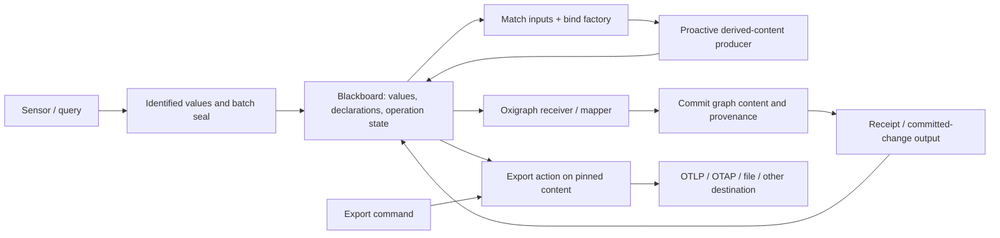

# Blackboard production, pending content, and receiving stores

[Module map](./README.md) · [Sensor routines](./sensor-routines0.gpt6a.md)

The later [virtual-blackboard thesis](../blackboard/thesis0.gpt6a.md) integrates
this production model with a private microdata/item view. Its small parts define
[work-child structure](../blackboard/structure0.gpt6a.md) and the
[received/work protocol](../blackboard/work0.gpt6a.md), including explicit rejection
reasons. This earlier note continues to own the production/receiver/export argument.

## The missing role

The human's refinement is broader than an object constructor: something **sees
values, declares what it can produce, and often proactively produces its own
content**. A blackboard production system is a useful working model for that.

The prior factory distinction still helps: a constructor binds an instance;
the surrounding runtime matches inputs, activates that instance and owns its
continuing work. We can call the whole facility a factory system while keeping
those smaller responsibilities inspectable. This note proposes their contracts;
it does not claim an implemented scheduler or settle the final vocabulary.

| Role | Job |
| --- | --- |
| Sensor | Observe a bound source and publish identified values/results |
| Blackboard | Expose available values, declarations, selected revisions and operation state to interested participants |
| Production rule | Declare accepted inputs, required services, produced content and activation policy |
| Factory binding | Match actual data/services to that rule and instantiate an owned producer |
| Producer | Generate or maintain output content, possibly before anyone asks to read it |
| Receiver/writer | Consume outputs and perform a declared persistence effect |
| Command/action | Request an effect against identified inputs and report its attempt/outcome |

These are roles an implementation can combine. A store-backed sensor observes
a query; its output can trigger another producer. The blackboard is a logical
coordination surface, not a requirement that every DOM mutation first be written
to Oxigraph. Transient live values and durable facts have explicit lifetimes.

## Content can be declared before it exists

A producer should be able to publish a content declaration naming its logical
output, shape/profile, available representation kinds, producer and bound scope.
Consumers can discover that output while it is waiting or being built.

Keep three identities visible:

- **Declared output:** the continuing content slot, such as telemetry for a
  reading session or observations for a particular conversation.
- **Output revision/batch:** the particular immutable values produced from a
  pinned input set, with readiness/completeness and provenance.
- **Production attempt:** the actual work that produced or failed to produce it.

A declaration is not empty content. A failed new production need not invalidate
an older usable revision. A consumer can explicitly request the selected ready
revision, inspect a partial revision, or wait for a requested input generation.

The rule can have one of several activation policies:

- **Proactive:** relevant inputs becoming available or changing schedule work.
- **On demand:** a consumer requests realization of a declared output.
- **Command-driven:** an explicit operation authorizes an effect or production.

Proactive production is a first-class mode. It is not implemented by pretending
some invisible user repeatedly called `get()`. A producer may also initialize
from configuration alone, and later react to incoming values. Policies can be
combined deliberately—for example, maintain normalized telemetry proactively,
but encode/export a selected batch only on a command.

## Matching and production

An illustrative declaration, not a selected serialization:

```text
trace-batch-production
  accepts: attempt-transition batches in reading-session scope
  requires: telemetry mapper at a declared profile/version
  produces: telemetry batch + content declaration
  activation: proactive on completed input batches
  key: rule revision + session identity + selected input revision(s)
  owner: reading-session producer lease

oxigraph-ingestion
  accepts: observation-result batches
  requires: dataset writer + mapping profile
  produces: commit receipt identifying stored graphs/results
  activation: proactive for the configured persistence route

export-telemetry
  accepts: export command + pinned eligible telemetry batch
  requires: encoder + selected destination adapter
  produces: export attempt, representation and delivery receipt
  activation: command-driven
```

Match data contracts, scope/join keys and service bindings together. Two inputs
that are each the “latest” value are not necessarily a coherent input pair.
Reuse the sensor-routine batch seal and revision rules. Redelivery of one batch
must not construct another identical child or repeat an already recorded effect.
An asynchronous old production can remain evidence about its inputs without
overwriting the selected output for newer inputs.

The first scheduler can use explicit registrations and conservative invalidation.
Describe each producer's read/write scopes, exclude its output from its own
triggers where appropriate, and reject undeclared cycles. Proactive does not
mean unrestricted repeated firing. Telemetry about store/export operations
particularly needs a policy preventing export diagnostics from perpetually
creating another immediately eligible export.

## “Pending traces” has several meanings

Read the human's “oltp” as **OTLP** unless corrected. **OTAP** is OpenTelemetry
Protocol with Apache Arrow, a column-oriented telemetry representation. Neither
name by itself specifies our work queue or a resource's lifecycle.

| State dimension | Example |
| --- | --- |
| Execution | A read attempt is still running, with a span under construction |
| Content production | A batch is declared or accumulating; a later revision will be sealed |
| Encoding | Normalized telemetry is ready but an OTLP/OTAP representation is not yet built |
| Delivery | The representation is ready and a destination-specific export is queued, sending, acknowledged, failed or uncertain |

An unfinished span is not interchangeable with a completed span awaiting export.
A batch can contain eligible completed spans while other attempts in the same
trace remain open; an exporter should not require the entire distributed trace
to be globally finished. Its policy states eligibility and completeness rather
than fabricating end times to make a payload look final. Pending/live state can
be retained in the local graph independently of external telemetry encoding.

Export intent names a pinned batch/revision, representation profile and destination.
The operation owns its own attempt IDs and retry state. It records the level of
acknowledgement actually received, including partial acceptance or uncertain
outcomes. Local deduplication cannot manufacture exactly-once remote delivery.
One destination's success does not mark the batch exported everywhere.

The inspected OTAP draft uses multiple related Arrow payload tables and stateful
gRPC streams. Its `batch_id` is stream-local; it is not our durable batch IRI.
Persist the correspondence in an adapter when needed. Raw stream fragments can
depend on earlier schema/dictionary state, so a portable stored representation
must include the needed decoding context or be encoded independently. We have
not verified browser OTAP encoding/transport support. Existing OTel-shaped JSON
alone does not establish a conforming OTLP or OTAP exporter.

## The Oxigraph reader is a receiving writer

In the user's pipeline, the Oxigraph-facing component **reads from the sensor**
and writes to the dataset. `Receiver` or `Writer` describes this direction well:



The receiver validates the selected mapping/input contract, preserves batch and
entry identities, records supporting observations and writes according to the
host's commit boundary. A partial sensor result retains its actual coverage;
it is not converted to complete membership by the act of storing it.

**Receive** usually means non-destructive observation or subscription: several
consumers can read the same result. **Take**, when used for a work queue, means a
scoped claim with ownership and acknowledgement. It should not delete the sensor's
source evidence. On failure or worker loss, claim/retry semantics determine
what may run again; a receipt means the defined commit succeeded, not merely
that a callback accepted the value.

Oxigraph then becomes a source as well: a query sensor can observe its committed
state and publish new values. The host supplies watch/scheduling semantics;
SPARQL query support alone does not provide them. This closes the productive
loop without requiring the writer, sensor and coordinator to be one opaque object.

## Ontology connections

- Sensor definitions remain `sosa:Procedure`; running evaluators can be software
  `sosa:Sensor`; their evaluations/results retain the existing observation mapping.
- Generic derivation or export is a `prov:Activity` with input/output entities;
  it need not be relabeled a SOSA observation merely because it reads values.
- Factory rules, input bindings, declared outputs, activation policy and work
  claims are our application profile, informed by the existing callable and
  provisioning precedents. The read vocabularies do not supply a blackboard executor.
- A newly encoded representation links to its telemetry source and encoding
  procedure. A delivery receipt links to the export attempt and exact representation.
- The [script host](../script-runtime/design0.gpt6a.md) installs the implementations
  that can fill these roles; installing code and activating a proactive producer
  remain separate lifecycle operations.

The first useful proof is one sensor batch feeding both an Oxigraph receiver
and a proactive telemetry producer, followed by a command exporting a pinned
ready batch. Demonstrate waiting declarations, duplicate delivery, an old
completion after new input, a failed store commit, and a pending export that
does not lose its input. These are proposed verification cases, not claims that
the runtime already exists.
