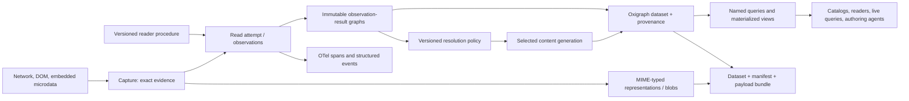

# Pageread — an observable, portable knowledge graph

[Module reading map](./README.md) · [Design corpus](../README.md)

## 1. Direction and standing

**Let pageread retain what it observed as a named, queryable graph, together
with the evidence and activities that produced it. Resolve current content
under an explicit policy. Make that whole account portable.**

The human progression matters: OTel-semconv microdata for ChatGPT sessions;
shared live selectors and multiple reactive indexes; an inspectable registry
of inflight work; then observations as an ontology and Oxigraph as a store
that can be dumped. This design develops that last direction while preserving
the earlier capabilities.

The intended result is useful at several levels:

- A person can read, find, and reopen their saved conversations.
- An authoring agent can inspect what a reader saw, why it interpreted it that
  way, and which capture to replay when improving the reader.
- A consumer can walk projects, transcripts, messages, observations, or running
  attempts now, then follow the relevant changes.
- Another process can load an exported dataset and ask those questions without
  depending on the original browser session.

**Standing:** commissioned design candidate. This document proposes graph-native
semantic authority as a destination. The existing trace/metadata hybrid remains
an implementation precedent, and its prior selection is recorded in
[AM round two](../reactive-indexes/draft1.gpt6am.md). Selecting this design for
implementation, moving write authority, and proving a browser package are
separate steps. Interface names and `pr:` terms below are proposed.

The checkout already contains an [Oxigraph experiment](../../experiments/graphs/)
using `oxigraph` declared as `^0.5.12`, named graphs, N-Quads, and an IDB
checkpoint. It is a useful narrow precedent. The inspected upstream archive is
a separately pinned revision; its API descriptions do not establish identical
capabilities in every released binding.

## 2. Architecture in one picture



The graph is the shared semantic model. Exact representations preserve evidence.
OTel describes execution and applicable AI interactions. Microdata exposes
entities on pages. Query/view definitions describe how those entities are read.

## 3. Terms that carry the design

| Term | Meaning |
| --- | --- |
| **Subject / entity** | The thing being described: a conversation, message, project, page, or artifact. Its identity survives successive readings. |
| **Representation** | Specific bytes, a MIME type, and a revision describing a subject. Semantic JSON, Markdown, and an HTML view can describe the same subject. |
| **Capture** | Recorded input from one acquisition: response bytes, stream segment, or a synchronized DOM snapshot, with acquisition metadata. |
| **Procedure** | A versioned way to acquire or interpret evidence: code, parameters, selectors, and semantic profile. |
| **Read attempt** | One actual invocation, with ownership, lifecycle, input references, and outcome. It can perform several observations. |
| **Observation** | An act of determining a property of a subject by a procedure, following SOSA's activity-oriented meaning. |
| **Observation result** | The values or assertions produced by that act. An assertion graph is one useful result representation. |
| **Coverage** | A claim about which subject/property/branch/range a result covers, and whether that specified scope was complete. |
| **Resolution** | Selecting or combining assertions under a named policy, recording support and unresolved conflicts. |
| **Generation** | An immutable coherent publication of resolved content or a view, bound to its input revisions and definition version. |
| **Catalog** | A discoverable collection of entries with labels, content references, MIME types, and navigation targets. |
| **Cursor** | An opaque position in a particular host's committed-change stream. It is not a content hash or upstream revision. |

Earlier documents sometimes use *observation* for the envelope or stored result.
Here `Observation` denotes the act; `ObservationResult`/`AssertionGraph` denotes
its output. The existing `ObservationEnvelope` is metadata that binds the two.

## 4. A small application ontology, grounded in existing vocabularies

### 4.1 Vocabulary roles

| Vocabulary | Reuse | Pageread interpretation |
| --- | --- | --- |
| **SOSA** | `Observation`, `Sensor`, `Procedure`, `hasFeatureOfInterest`, `observedProperty`, `hasResult`, `usedProcedure`, `madeBySensor`, `phenomenonTime`, `resultTime` | Describe the act of finding something out. A software reader can be a sensor. |
| **PROV-O** | `Activity`, `Entity`, `SoftwareAgent`, `used`, `wasGeneratedBy`, `wasDerivedFrom`, `wasAssociatedWith`, `specializationOf`, `wasRevisionOf` | Connect exact inputs, interpreting activities, results, revisions, and responsible software. |
| **Schema.org** | `Conversation`, `Message`, `CreativeWork`, `name`, `text`, `hasPart`, `isPartOf`, `encodingFormat` | Describe content in recognizable web terms where definitions fit. Pageread adds AI-specific roles, branches, and parts. |
| **OTel** | Span/event/log structures and applicable versioned semantic conventions | Execution traces and AI-interaction representations, linked to the entities they describe. |
| **Pageread profile** | Coverage scopes, assertion graphs, resolution selections, branch memberships, view definitions/generations, commit receipts | Supply the relationships and operating rules specific to this application. |

This is a deliberately small profile. A readable term registry, mapping rules,
validation constraints, and examples are the first ontology deliverables.
Explicitly write types that queries depend on; merely loading vocabulary
definitions does not provide an OWL inference service.

Schema.org `Observation` can expose a compact finding (`observationAbout`,
`measuredProperty`, `value`, `observationDate`, `measurementMethod`). Its
result-oriented use differs from SOSA's activity. A mapping must preserve that
distinction rather than declare the two classes identical.

SOSA `Sample` describes a subset or proxy studied on behalf of a larger feature.
A sampled page fragment may fit. A single probe invocation is an observation
attempt; no physical sampling metaphor is needed for every capture.

### 4.2 Proposed pageread terms

Group the registry by concern rather than producing one unstructured list:

- **Content:** `Project`, `Branch`, `MessageRevision`, `ContentPart`,
  `Membership`; `revisionOf`, `member`, `position`, `parentMessage`, `role`.
- **Evidence:** `Capture`, `Representation`, `AssertionGraph`, `CoverageScope`;
  `capturedAt`, `bodyHash`, `byteLength`, `coverage`, `scope`, `sourceRevision`.
- **Execution:** `ReadAttempt`, `ResolutionActivity`, `AttemptTransition`;
  `procedure`, `partOfAttempt`, `state`, `ownerEpoch`, `input`, `output`.
- **Resolution:** `ResolutionSelection`, `Conflict`; `selectedRevision`,
  `policy`, `support`, `candidate`, `reason`.
- **Views:** `ViewDefinition`, `ViewGeneration`, `CatalogEntry`;
  `selectedGeneration`, `contentGraph`, `supportGraph`, `sourceCursor`,
  `contentRef`, `openTarget`, `readiness`.

Names are proposed, not a completed ontology release. Start with only terms
needed by the first fixture. In examples, `pr:` expands to
`https://example.org/pageread/vocab/0#`, explicitly a placeholder namespace.
Choose an owned, maintainable namespace before durable publication; this
example namespace must not accidentally become a production identity contract.

### 4.3 OTel names need an explicit mapping

`gen_ai.request.model` is an OTel attribute key, not an absolute RDF predicate
IRI. Define a versioned mapping into owned predicates or attribute nodes;
retain the original key and semconv version for export. Unknown attributes
remain representable as typed key/value nodes. Known fields may have direct
predicates for convenient queries, with an unambiguous round-trip mapping.

The initial `https://opentelemetry.io/semconv/span`-style item types in
[`schema/src/vocab.ts`](../../schema/src/vocab.ts) are project inventions, not
upstream declarations of RDF classes. Preserve imported spellings as provenance;
publish our adaptations under our authority. Exact IRI equality governs graph
terms; a trailing-name match is only a reader heuristic.

### 4.4 Profile validation makes the vocabulary usable

The first profile specifies application constraints as well as term meanings:

- A sealed assertion graph has an observation binding, a procedure/profile
  version, one declared semantic scope, and one coverage classification. A single
  acquisition can generate several graphs when its scopes differ.
- A successful observation identifies its target, observed property, and result.
  A failed attempt records failure without inventing a successful empty result.
- A selected generation identifies its definition/policy, exact inputs, content
  graph, and support graph. Its required representations are available before
  selection. A provisional conflict selection carries its reason.
- Every current message occurrence identifies its branch/sequence and position.
  A source with only partial ordering keeps that uncertainty; the UI may use a
  labeled presentation order without asserting it as upstream chronology.
- Attempt ownership, recorded state, and trace correlation have separate fields.
  Replaying an imported record cannot create a live execution owner.

Unknown source properties and lexical values can be retained as evidence while
the mapper reports what it could not interpret. Validation is scoped to this
profile, not a claim that every external RDF graph must satisfy pageread's
cardinalities. Begin with fixtures and application checks; a machine-readable
shape document can express the same constraints as the profile stabilizes.

## 5. Identity, revisions, order, and clocks

**Repeated readings of one message create distinct attempts and results about
one stable subject.** Deduplicating a message must not erase repeated acquisition.

| Identity | Scope / rule |
| --- | --- |
| Conversation/message | Provider + account/workspace + native conversation/message key, encoded unambiguously. |
| Provisional DOM subject | Reader/session-local identity marked provisional; later association with a native subject is an explicit resolution. |
| Attempt | Unique per real execution. A command retry may reuse a command idempotency key, while an actual re-execution receives its own attempt ID. |
| Capture/result | Immutable acquisition/result identity. Retried delivery of the same sealed result is idempotent. |
| Representation revision | Exact bytes plus relevant representation metadata under a specified versioned identity rule. A body hash alone is insufficient. |
| Source revision | Provider-supplied value. Equality is useful; ordering requires the provider's comparison rule. |
| View generation | Definition/policy version + selected input revisions + published artifacts. |
| Host cursor | Scoped to dataset identity and epoch; portable as provenance, not automatically resumable in an imported host. |

Existing `urn:pageread:*` addresses remain valid. Keep logical subject IDs,
representation IDs, graph names, and trace/span IDs distinguishable. Trace IDs
for repeated extraction attempts are fresh execution identities; a deterministic
ID used by a historical transcript projection is separately labeled as derived.

RDF is a set of statements. Preserve order through explicit membership/occurrence
nodes with positions within a branch or sequence. Equal text in two messages,
two equal SSE chunks, and repeated span events can be different occurrences.
Message revision identity is separate from branch position; moving a message
does not require changing its content revision.

Preserve these clocks independently when the evidence supplies them:

1. Source event time, such as a message's reported creation time.
2. Acquisition/observation time at the reader.
3. Procedure execution start/end and result availability time.
4. Local commit time/order.

OTel's `Timestamp`/`ObservedTimestamp` distinguishes source events from their
collection. SOSA's `phenomenonTime`/`resultTime` distinguishes when a result
applies from when it became available. These pairs are related but not blindly
interchangeable. Missing source time remains unknown. Nanosecond integers use
lossless strings/integer datatypes; they never transit through JS `number`.

## 6. Dataset organization and semantic authority

### 6.1 Named graph roles

| Graph role | Contents | Lifecycle |
| --- | --- | --- |
| Evidence metadata | Captures, attempts, observation/result bindings, procedure versions, coverage | Seal results; record attempt transitions separately |
| Observation-result graph | Assertions produced for one semantic scope by a reader | Immutable after publication; corrections create another result |
| Resolved-content graph | Selected values and memberships for a particular generation | Immutable generation |
| Resolution-support graph | Which evidence supports each selected field/relation, conflicts, policy explanation | Published with its resolved generation |
| Authored catalog/override graph | User-authored names, descriptions, memberships, or scoped overrides | Explicit revisions; never silently rewritten by extraction |
| View/control graph | Definitions, selected-generation pointers, host epoch/head, committed-change records | Written through the host's publication boundary |

A graph name is an address, not inherent provenance or authority. Metadata
describes what the graph represents. Reader submissions supply assertions into
assigned evidence graphs; the host owns publication/control records.

The default query dataset is explicitly chosen. Evidence inspection names
observation graphs; current-content queries follow a selected generation.
Unioning all graphs is useful for exploration but would mix historical,
conflicting, provisional, and resolved claims. It is never the implicit
definition of current truth.

Empty result graphs are represented in metadata even if a serialization omits
the empty graph itself. A complete empty listing is distinct from a failed
probe or an unpublished result.

### 6.2 One semantic writer boundary

Readers propose observations. A host validates the proposed profile and commits
evidence. A resolver proposes a selected generation. Consumers and catalog
adapters read the published selection. User edits enter as explicit assertions
with their own provenance and scope.

In the graph-native destination, source documents remain immutable evidence and
representations of the selected graph can be generated. There is one route for
semantic mutation. Writable JSON bodies and unrestricted SPARQL updates must not
become competing authorities for the same selected field.

During adoption, RDF can remain a projection of the existing observation-bound
documents. That phase explicitly names the documents as authoritative. Promotion
to graph-native authority is a deliberate cutover with import fixtures, exact
representation preservation, and compatibility adapters; it is not implied by
loading a dataset into Oxigraph.

## 7. Resolution: explain what was selected

Coverage is attached to a **scope**, minimally subject, property/domain, branch
or source view when applicable, and range/pagination boundary. A result that
completely captures a title and partially captures messages needs two scoped
claims. `covers: [m1, m2]` names seen entities; it does not define the universe
against which m3's absence can mean anything.

Resolution policy is versioned and field-aware:

| Situation | Proposed behavior |
| --- | --- |
| Duplicate delivery of the same result | Return its existing receipt; do not create duplicate evidence or membership. |
| New attempt yielding equal content | Preserve the new attempt/result; reuse identical representation bytes if useful. |
| Partial/unknown result | Contribute explicit assertions within its scope; missing entities imply no removals. |
| Comparable newer source revision | May replace older claims in the same authority/scope; completeness is assessed separately. |
| Comparable older result arriving later | Preserve evidence; do not roll back newer selected claims. |
| Incomparable conflicting claims | Retain candidates and surface a conflict; a display preference records its provisional reason. |
| Explicit clear/deletion | Require a scoped assertion and source authority/precedence; distinguish from an absent field. |
| Authoritative complete scoped replacement | May retract selected membership within that exact scope when revision precedence permits. Preserve observation history. |

Example: complete branch R10 contains m1 and m2. Partial R11 updates m1.
The selected content is **R10 baseline + R11 overlay**, retaining m2. It is
not falsely labeled a complete R11 capture. A tab's selected branch is contextual
to that reading session; it is not automatically the conversation's global branch.

Resolution support can begin with ordinary statement/selection nodes referring
to subject, predicate, selected value, source graph, and policy. RDF reification
describes a statement; the corresponding selected triple must also be written
when intended. This avoids depending on RDF-star/RDF 1.2 support in every host.
Use coarse provenance only when it truly supports the entire derived artifact.

An RDF query can enumerate candidates and policy inputs. The resolution rule
itself may be ordinary tested TypeScript/Rust. Declaring an ontology does not
determine how to reconcile disagreement.

## 8. Worked dataset and useful queries

The companion [TriG example](./observations0.gpt6a.trig) contains two observations
of a branch, a complete baseline and a newer partial overlay, two retained
messages, exact tiny capture bodies, a resolved generation, field support, and
a recorded running attempt. All data is fictional and uses example IRIs.

It is a hand-authored expected state, not a resolver implementation. These
queries exercise why a graph is useful.

### 8.1 Walk the selected messages, in branch order

```sparql
PREFIX pr: <https://example.org/pageread/vocab/0#>
PREFIX schema: <https://schema.org/>
SELECT ?message ?position ?text WHERE {
  GRAPH <urn:pageread:example:control> {
    <urn:pageread:example:messages-view> pr:selectedGeneration ?generation .
    ?generation pr:contentGraph ?content .
  }
  GRAPH ?content {
    ?membership pr:branch <urn:pageread:example:branch-main> ;
                pr:member ?message ; pr:position ?position .
    ?message schema:text ?text .
  }
} ORDER BY ?position ?message
```

Expected: m1 = `Hello, revised`; m2 = `Keep this message 🌍`. The partial result
does not remove the second message.

### 8.2 Explain a selected text value through its source observation

```sparql
PREFIX pr: <https://example.org/pageread/vocab/0#>
PREFIX schema: <https://schema.org/>
PREFIX sosa: <http://www.w3.org/ns/sosa/>
PREFIX prov: <http://www.w3.org/ns/prov#>
PREFIX rdf: <http://www.w3.org/1999/02/22-rdf-syntax-ns#>
SELECT ?value ?evidence ?observation ?procedure ?capture WHERE {
  GRAPH <urn:pageread:example:control> {
    <urn:pageread:example:messages-view> pr:selectedGeneration ?generation .
    ?generation pr:supportGraph ?support .
  }
  GRAPH ?support {
    ?selection rdf:subject <urn:pageread:example:m1> ;
               rdf:predicate schema:text ; rdf:object ?value ;
               prov:wasDerivedFrom ?evidence .
  }
  GRAPH <urn:pageread:example:metadata> {
    ?observation sosa:hasResult ?evidence ; sosa:usedProcedure ?procedure ;
                 prov:used ?capture .
  }
}
```

The selected text leads to overlay evidence, its procedure version, and capture.
A different query can enumerate both source texts without treating both as
current. This is provenance as a working interface.

## 9. OTel and the inflight registry

The execution registry describes attempts explicitly. A small lifecycle is
`queued → running → succeeded | failed | cancelled`; an unreconciled prior owner
can leave an attempt `interrupted` or with unknown outcome. Recovery retains that
uncertainty. Retry scheduling creates a related new attempt rather than inventing
a successful completion for the old one.

Each attempt records procedure/version, input references, owner/runtime epoch,
start/end when known, progress checkpoints, output result IDs, error information,
and trace correlation. Multiple observations can belong to one attempt. For a
single-property probe, one activity can carry both roles if the mapping says so.

| Semantic occurrence | OTel exposure |
| --- | --- |
| Read/resolve/index attempt | Span with fresh execution identity and applicable parent/links |
| Observation result available | Structured log/event with result reference and observation identity |
| Milestone during an attempt | Span event where its lifetime/retention fits |
| Numeric reading or aggregate | Metric measurement; an exemplar may correlate a retained measurement with execution |
| Historically observed AI interaction | Qualified GenAI representation using the pinned semconv profile and actual available evidence |

Span absence or a missing end time is not sufficient to classify live work.
Registry state plus ownership establishes current activity. Imported recorded
`running` state is historical evidence; it does not resurrect a worker.

The observed subject belongs in an explicit target/content reference. OTel
`Resource` describes the telemetry-producing entity; it should not silently
become the conversation being inspected. Instrumentation scope can identify the
reader instrumentation/version. Source event timestamps and collection clocks
remain distinct, and missing usage/model/timing data is not fabricated.

Durable operational progress and best-effort telemetry have different delivery
needs. The host records lifecycle transitions required for recovery; exporting
the corresponding telemetry must not recursively create endless new ingest work.

## 10. Reactive queries, catalogs, and search

### 10.1 Many logical indexes over one shared dataset

An index/view definition has an IRI, version, parameter schema, source-graph
selection, query/transform definition, result schema, and materialization policy.
Examples include all transcripts for an account, all projects, messages in one
branch, unresolved observation conflicts, and attempts owned by this runtime.

Parameterized instances keep separate identities and subscriptions while sharing
extraction, graph storage, and physical search structures. Registering a new view
should not require a bespoke full-corpus indexer implementation.

A query result includes its definition version, selected generation, covered
cursor, and readiness (`building`, `ready`, `stale`, `failed`). No matches is a
successful result only once the query has actually evaluated its stated inputs.
Consumers can request a pinned generation or follow the latest selected one.

### 10.2 Changes drive evaluation; signals expose values

Oxigraph's inspected interfaces supply queries and updates, not the proposed
durable live-query service. Pageread supplies a publication coordinator:

1. Serialize commits through one owner for the initial host.
2. Commit evidence/control changes and a change record together in the host's
   authoritative persistence boundary; acknowledge only that boundary.
3. Publish a hint containing dataset/epoch/head. The hint is not the history.
4. Evaluate affected views against a consistent snapshot. Start with explicit
   graph dependencies and conservative invalidation; joins, negation, and
   aggregates make naive subject-only dependency tracking insufficient.
5. Publish a coherent result generation. If relevant changes arrive during a
   build, mark it dirty and run again. An older completion cannot replace a newer
   selected generation.

Full rebuild is a valid first evaluator and correctness oracle. Shared extraction
and per-source replacement can follow. Persisted postings are an optimization
with a mapping/version and input identity; lean snapshots are not a universal law.

Declare source/output graph dependencies and reject view cycles in the initial
engine. Control-pointer writes and a view's own output are excluded from its
source subscriptions. This avoids both self-feedback and two broad views
continually rebuilding from one another's output.

`watch` attaches from a snapshot paired with its cursor, or requests changes after
a cursor. Bootstrap and catch-up are serialized so no commit falls between the
snapshot and subscription. Coalesced invalidations mean re-read current state;
historical state replay requires retained generations or quad deltas. Advertise
these as different capabilities. Reconnection catches up or returns an explicit
reset requirement. No automatic retention/pruning is proposed.

Extension messages bridge website/content-script and extension storage contexts.
BroadcastChannel is only a same-storage-context hint mechanism. Worker restarts
and lost hints are repaired from durable state, not assumptions about port life.

### 10.3 Content Index as an exposure

A catalog entry references a subject or pinned representation and an actionable
`openTarget`, with title, description, icon, category, MIME information, and
coverage/readiness. Authored labels remain authored assertions; derived labels
can change with selected content. Entry membership has its own identity/revision.

The browser Content Index facade projects only its actual fields: `id`, `title`,
`description`, `url`, `category`, `icons`. Its `url` is an offline-capable page
within the service-worker scope. An internal URN is a content identity; a viewer
route provides the launch URL. MIME types and subscriptions are pageread
extensions. Browser registration is optional and feature-detected.

### 10.4 Text find and native reveal

Literal substring/phrase find and token/ranked search are separate query modes.
Both consume extracted fields tied to exact selected revisions. The first literal
mode can scan fields; a shared text accelerator can follow measurements. SPARQL
can select eligible entities; that does not imply a ready-made full-text engine.

Hits name subject, content revision, field/part, position, and navigation target.
Specify UTF-16 code-unit offsets for the initial browser-facing protocol; Rust
adapters convert explicitly. Preserve original text and an offset map if a search
mode normalizes it.

`beforematch` with `hidden="until-found"` helps reveal searchable text already
present in an owned viewer DOM. It does not hand arbitrary stored graphs to the
browser's Ctrl+F engine. Corpus search is our query service; native find remains
a rendering integration with separately tested behavior.

## 11. Oxigraph hosts and committed publication

### 11.1 Shared semantics, explicit backend capabilities

The host advertises dataset query, exact-representation access, publication,
snapshot export, and any watch/replay capabilities. A conceptual surface is:

```text
submitObservations(proposal, commandKey) -> receipt
resolve(scope, policyVersion, expectedInputs) -> generation
query(viewOrQuery, parameters, at?) -> result + coveredRevision
content.match(resource, representation, revision?) -> MIME + bytes
watch(view, after?) -> snapshot/deltas or resetRequired
export(scope, at, payloadPolicy) -> bundle
```

These are application operations, not claimed Oxigraph or ACP/A2A methods.
Read-only SPARQL is a useful authoring tool. Publication commands ensure writes
retain the same provenance and lifecycle meanings as packaged readers.

### 11.2 Browser-local reference path

The inspected JS/WASM store is in memory. Use it in an extension-owned context
for query/evaluation; make browser durability explicit.

A small first durable host can reuse the experiment's **one checkpoint record**:

1. Start from the last committed dataset/checkpoint.
2. Build and validate a private candidate dataset and its receipt/head.
3. Serialize the candidate plus small exact representations into one IDB record.
4. Await IDB transaction completion, then select the candidate in memory and
   notify consumers. Before commit, readers continue to see the prior selection.
5. On worker restart, load that checkpoint and rebuild query state.

A failed write never publishes the candidate. A crash after durable commit but
before notification is recovered by attachment/head checks. This deliberately
costs full serialization/copying; measure it before evolving to a durable delta
log plus checkpoints. A dump created only when the UI closes is not this protocol.

Large immutable blobs can be staged separately, verified, and referenced by the
checkpoint manifest. Acknowledged publication requires its required bodies to
exist. Extra staged bodies after a failed publication are left for deliberate
maintenance. Browser quota errors leave the previous committed selection intact.

### 11.3 Native host path

Native Oxigraph uses RocksDB. The inspected Rust store documents atomic
transactions and repeatable-read operations. A native host can transactionally
commit assertion quads, generation selection, and the change cursor/record.
All writers participate in that boundary; arbitrary out-of-band updates would
bypass the reactive contract.

Keep separate blob storage immutable and publish references after staging, as
above. Do not assume a transaction spans RocksDB and arbitrary filesystem writes.
Durability settings and termination behavior require host-specific tests; API
atomicity alone is not a claim about every power-loss scenario.

Potential Rust responsibility groups are `ontology` (terms/mappings), `store`
(dataset/representations/publication), `views` (query generations/watch), and
`host` (browser/native transport). These are design boundaries, not a commission
to create empty crates. Any Rust implementation uses `tracing` and meaningful
`tracing-test` coverage for commit, recovery, and attempt lifecycles. ACP/A2A can
adapt a host's capabilities once their extension mechanisms are checked; a chat
session's lifetime does not own the retained dataset.

## 12. Portable export and restoration

**The useful artifact is the dataset plus its evidence closure.** A bare RDF dump
is also useful, but its payload coverage must be declared.

```text
pageread-export/
  manifest.json
  dataset.trig                 # or dataset.nq
  blobs/<sha256>               # required exact bodies, when included
  definitions/                # referenced profile/query/mapping artifacts
```

The manifest declares format/profile versions, originating dataset identity,
snapshot cursor, selected generations, graph roles, representation references,
body hashes/lengths/MIME types, included definitions, and any deliberately
external or missing dependencies. A scoped export includes the relevant support
graphs, observations, procedure references, and captures, or records the omitted
closure explicitly. Executable procedure code is a separately declared artifact;
a version label alone does not promise executable replay.

Use **TriG** for readable datasets with named graphs and **N-Quads** for
line-oriented interchange. Turtle is appropriate for an individual graph, but
does not by itself preserve a whole dataset's named-graph boundaries. JSON-LD
is another possible exposure when the chosen binding/profile supports it.

Distinguish two integrity properties:

- **File/body integrity:** a hash over the exact exported bytes checks transfer.
- **Dataset equivalence:** RDF terms and graph names survive import, modulo blank
  node renaming. Serializer order and blank-node labels are not a semantic hash.
  If semantic content addressing is needed, choose and test a dataset
  canonicalization profile explicitly.

Stable cross-capture entities and graph names use IRIs. Blank nodes may describe
local structure; their labels cannot be treated as globally mergeable IDs.
Normalize neither the source bytes nor opaque source revisions during import.

Export against a frozen consistent snapshot so head, graph contents, and selected
generations agree. Restore into a fresh candidate host, validate required closure,
load quads, verify payload hashes, and query before selecting it for use. A failed
restore does not replace the current dataset. Dataset dump is state, not an
operation-history guarantee; include the retained journal explicitly if needed.

An import receives a new live host epoch and local cursor lineage. Original
cursors remain provenance; original running attempts remain recorded history.
Imports into an existing dataset enter as source-scoped observations and use the
normal resolution policy. Concatenating two dumps is not a conflict policy.

## 13. Reader DSL, microdata, and authoring

A recipe should make its semantic production inspectable:

```text
sources       network patterns, DOM queries, embedded item types
procedure     implementation reference + version/digest + configuration
interpret     captures -> scoped observations and result proposals
profile       vocabulary version, OTel mapping, representation codecs
publish       evidence scopes and resolver policy selection
views         catalog/query definitions and parameter bindings
fixtures      captures, expected assertions, coverage, and round-trip cases
```

The same interpreter can run under extension capture or a Playwright fixture.
An authoring agent can preview assertions, inspect conflicts, walk entity graphs,
query supporting captures, and export a reproducer before packaging a change.
Definitions can themselves be cataloged entities with provenance; runtime code
is still a packaged artifact, not a string silently executed from an RDF value.

Microdata remains a useful HTML exposure of this ontology. Resolve item IDs and
URL-valued properties against the correct document base; preserve repeated
property order where the profile requires it; distinguish literal strings from
IRI references. Typed datatypes and lists need explicit conversion rules. A
page's markup supplies claims with source provenance; its declared type does not
establish the host's interpretation or completeness. Existing extraction is a
subset and should be verified against conversion fixtures before claiming a
conforming RDF mapping. JSON-LD and TriG can expose the same identified entities.

The shared DOM router remains a separate useful capability: one observer owner
per observable realm/root, many query consumers, content-change invalidations as
well as membership changes, and explicit disposal. DOM batches feed observation
attempts; signal adapters expose current query values. Persisted commits have
their own continuity contract.

WXT owns extension packaging; tsdown's unbundled output expresses the preference
for real inspectable modules. Inspect the final WXT/Vite module graph rather than
assuming library unbundling prevents downstream rebundling. Oxigraph's JS glue
and WASM asset must be packaged and loaded in the chosen extension context, with
its actual CSP/module requirements tested. Vite+ compatibility remains an
integration question. Browser bundling constraints do not dictate the ontology.

## 14. Landing sequence and proof obligations

Each slice earns a checkpoint, including useful failing or incomplete states
before a redesign. No wholesale replacement of the current scaffold is needed
to learn whether this architecture helps.

1. **Profile and graph fixture.** Define the minimum observation/result/coverage
   terms, two observations of one conversation, exact capture representations,
   current-content and provenance queries. Dump/reload with equivalent answers.
2. **Interpretation parity.** Feed one capture through the existing reader seam
   and a graph mapper. Preserve OTel-oriented representations and exact bytes;
   compare entity identities, message text, branches, and coverage. RDF is still
   a labeled projection at this point.
3. **One real publication loop.** Browser extension capture → interpretation →
   durable checkpoint → transcript/message views. MSW supplies varied network
   contexts; Playwright exercises the actual source/bridge path and DOM fallback.
   Record platform limitations honestly. This can precede a generalized journal.
4. **Authority and recovery.** Select the graph-native writer boundary if the
   proof warrants it. Serialize publication, expose readiness and attempt state,
   recover after worker restart, and add resumable committed-change delivery.
5. **Shared reactive views and portable bundles.** Independent named catalogs,
   definition versions, pin/follow behavior, coherent search generations, scoped
   export, native-host round-trip when that host exists.

Important checks are behavioral, not snapshots of implementation details:

| Check | What it establishes |
| --- | --- |
| Complete R10 + partial R11 | m1 updates; m2 remains; coverage is baseline plus overlay |
| Older capture delivered last | Arrival order does not roll back a comparable newer claim |
| Conflicting incomparable sources | Alternatives and selected/provisional reasons remain inspectable |
| Equal content from two attempts | One subject, two acquisitions, no lost provenance |
| Empty complete result vs failed attempt | Different queryable outcomes, with no invented successful emptiness |
| Branch changes and shared message | Membership removal is scoped; another branch retains its member |
| Repeated identical events | Occurrence count and ordering survive graph encoding and export |
| Snapshot/finder build races | Older completions cannot select over newer generations |
| Commit then lost notification | Reattachment observes committed state and correct cursor |
| Worker termination before commit | No acknowledged partial generation |
| Dump/import with emoji, datatypes, blobs | Equivalent graph answers, specified offsets, exact required bytes |
| Imported inflight state | Recorded history remains; no accidental resumption |
| Catalog + beforematch viewer | Available-content discovery and in-page reveal each exercise their actual API |

## 15. Choices still open

- **First host:** browser WASM + durable checkpoint fits extension-local use;
  native Oxigraph fits a long-lived local service. Measure corpus size and wake
  cost before selecting native deployment as a requirement.
- **Graph granularity:** one result graph per scoped observation is explainable;
  stream-heavy ingestion may warrant sealed batches with per-occurrence identity.
- **Source policy:** which ChatGPT endpoints establish completeness, revisions,
  branches, or deletion? Answer from captures, not ontology inference.
- **Semantic profile:** final owned namespace, exact semconv version, compatible
  microdata/JSON-LD mappings, and treatment of unsupported source values.
- **View artifacts:** persisted extracted text or posting segments should follow
  cold-start/search evidence. Their format need not dictate the graph model.
- **Graph-native promotion:** the migration boundary from the already described
  trace/metadata hybrid needs an explicit decision and demonstrated parity.

The design's acceptance question is concrete: **can we read a page twice, explain
what changed and why, lose the worker, and still reopen or export the same
understanding with its evidence?**

## 16. Connections and evidence boundary

- [Original OTel-microdata wave](../otel-microdata/draft0.glm53m.md): origin of the
  capabilities and preserved simplifications. This proposal repairs the earlier
  assumption that idempotent full rebuilds are automatically race-safe, and gives
  inflight work explicit lifecycle semantics.
- [AM round one](../reactive-indexes/draft0.gpt6am.md): committed-change recovery,
  coverage, shared physical indexing, and literal-find distinctions carry forward.
- [AM round two](../reactive-indexes/draft1.gpt6am.md): strong precedent for scoped
  assertion resolution, source authority, and exact-document preservation. This
  proposal explores graph-native semantic authority beyond its initial projection
  recommendation, preserving that migration decision as open.
- [Independent toolkit design, §§1–4](../tabula-rasa/design0.gpt6a.md): addressable
  representations, reading-session ownership, and public surfaces align with this
  host interface. Its initial browser-IDB recommendation is another deployment
  candidate; this document does not claim to supersede its reviewed contracts.
- [Graph experiment](../../experiments/graphs/src/engine.ts) and
  [checkpoint adapter](../../experiments/graphs/src/checkpoint.ts): implementation
  precedents for standard dumps plus exact documents. Source inspection alone
  establishes neither a production commit protocol nor browser lifecycle proof.

Primary sources above establish vocabulary meanings and inspected library/API
capabilities. The architecture, resolution policy, profile, host protocol, and
landing sequence are proposals.

### Worked-example verification — 2026-10-20

The [companion verifier](./verify0.gpt6a.mjs) was run using the already installed
`oxigraph@0.5.12` from `experiments/graphs`. It loads the **170-quad** fictional
dataset and checks both SPARQL blocks in this document, selected-message values
and order, provenance back to the overlay capture, isolation of named graphs,
both historical text candidates, the exact embedded capture string, and the
recorded running attempt without a fabricated observation result.

It repeats those checks after **TriG and N-Quads dump/reload** and compares the
complete quad sets. Both formats passed. This IRI-only fixture does not test
blank-node canonicalization, a resolver implementation, arbitrary binary blobs,
or browser/native worker recovery. Those remain the proof obligations above.

Run from the repository root, with the graph experiment's dependencies present:

```sh
node design/ontology/verify0.gpt6a.mjs
```
